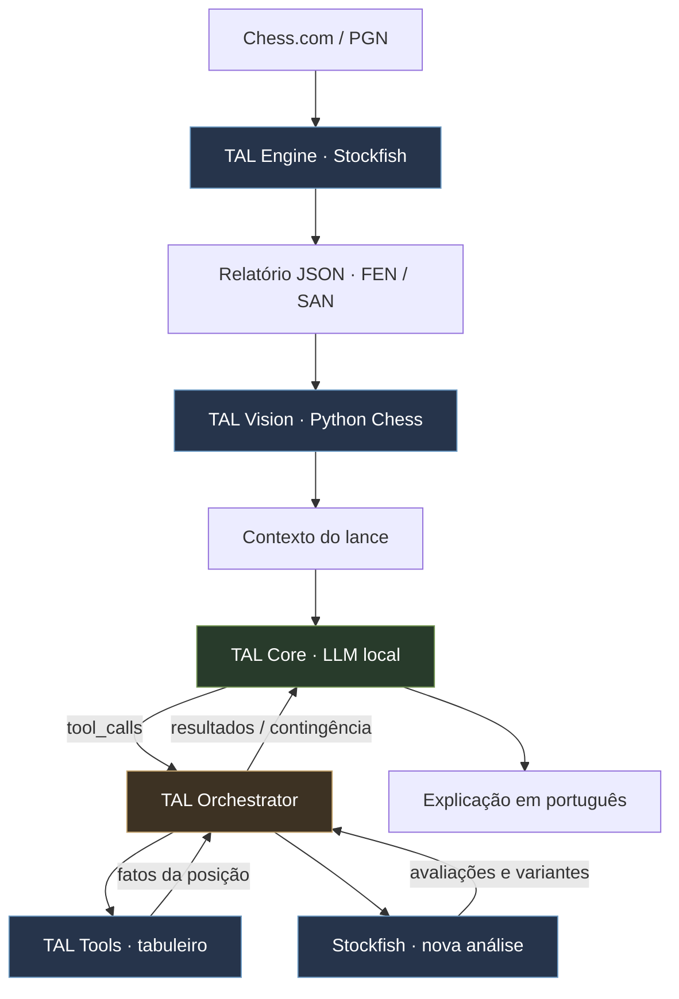

<div align="center">

# ♞ T A L

### CHESS INTELLIGENCE

**Calcule com precisão. Entenda cada lance. Aprenda com cada partida.**

Um treinador de xadrez com inteligência artificial local, que une a capacidade de cálculo do Stockfish à interpretação de linguagem natural e à investigação de posições reais.

[](#roadmap)
[](https://www.python.org/)
[](https://stockfishchess.org/)
[](https://github.com/ggml-org/llama.cpp)

[Visão geral](#visão-geral) · [Arquitetura](#arquitetura) · [Instalação](#instalação) · [Comandos](#comandos) · [Roadmap](#roadmap)

**♜ ♞ ♝ ♛ ♚ ♝ ♞ ♜**

</div>

---

## Visão geral

O **TAL** é um projeto de inteligência artificial especializada em análise pós-partida de xadrez. Em vez de tentar substituir uma engine, o TAL combina componentes especializados: o Stockfish calcula, o Python Chess interpreta o tabuleiro e um LLM local explica os resultados em português brasileiro.

A proposta é ir além de mostrar a melhor jogada: ajudar o jogador a entender **por que uma decisão foi boa ou ruim**, quais oportunidades surgiram e o que aprender com a posição.

> **A engine calcula. O Vision observa. O agente investiga. O jogador aprende.**

| Análise | Inteligência | Controle |
| :--- | :--- | :--- |
| Importação de partidas públicas do Chess.com e PGN local | Explicações em português com LLM local | Consultas limitadas e rastreáveis |
| Avaliações, variantes e classificação dos lances | Reconstrução de posições por FEN | Verificação de legalidade com Python Chess |
| Relatórios JSON para revisão e experimentos | Oito ferramentas de investigação | Contingência quando o modelo não consulta ferramentas |

**Estado atual:** v1.3.1 experimental. A execução das ferramentas foi demonstrada com um LLM e Stockfish locais. A contingência está implementada, mas ainda requer validação de ponta a ponta. O TAL ainda não verifica semanticamente todas as afirmações da resposta final.

## Arquitetura



### Componentes

| Módulo | Responsabilidade | Estado |
| :--- | :--- | :---: |
| **TAL Engine** | Importação, análise UCI, avaliações e relatórios | Implementado |
| **TAL Coach** | Explicações e chat sobre relatórios | Implementado |
| **TAL Vision** | Peças, casas, capturas, xeque, mate e roque | Implementado |
| **TAL Tools** | Consultas dinâmicas ao tabuleiro e Stockfish | Experimental |
| **TAL Orchestrator** | Ciclo de chamadas, limites e contingência | Experimental |
| **TAL Validator** | Validação factual das respostas finais | Planejado |
| **TAL Knowledge** | Base de conhecimento e recuperação de teoria | Planejado |

### Ferramentas do agente

| Ferramenta | O que faz |
| :--- | :--- |
| `get_board` | Retorna a posição e suas peças. |
| `inspect_square` | Identifica a peça em determinada casa. |
| `get_legal_moves` | Consulta as jogadas legais. |
| `get_attackers` | Identifica ataques geométricos a uma casa. |
| `simulate_move` | Simula uma jogada sem alterar a partida. |
| `analyze_position` | Solicita uma nova avaliação ao Stockfish. |
| `compare_moves` | Compara duas alternativas na mesma perspectiva. |
| `validate_sequence` | Verifica a legalidade de uma sequência. |

As ferramentas aceitam uma posição anterior ou posterior ao lance e podem aplicar uma linha hipotética de até oito movimentos SAN. O agente permite de uma a seis consultas (quatro por padrão), com profundidade de análise limitada a 18. Se o modelo não consultar uma ferramenta válida, a contingência pode acionar uma comparação ou análise do Stockfish. O modo `--strict-autonomy` permite testar o modelo sem essa intervenção.

## Demonstração

Exemplo simplificado de uma investigação local já realizada, a partir de uma partida encerrada:

```text
TAL > Compare Nf6 e dxc4.

[TOOL] compare_moves
       Profundidade: 14 | Perspectiva: pretas

       Nf6   +0.24  · sem captura
       dxc4  +4.53  · captura do bispo branco

       Diferença entre alternativas: 429 centipeões.
```

Esses números vêm dos resultados estruturados de uma consulta ao Stockfish. A explicação textual do LLM ainda pode conter erros; a comparação acima apresenta os fatos da ferramenta, não uma transcrição da resposta final do modelo.

## Instalação

### Pré-requisitos

- Python 3.10 ou superior (3.12 recomendado).
- Stockfish instalado localmente.
- Para o Coach e o agente: um servidor LLM compatível com a API OpenAI, com suporte a tool calling para o agente.

### 1. Obter o projeto

```bash
git clone --branch feature/tool-calling https://github.com/Cassian0S0ares/TAL.git
cd TAL
```

### 2. Instalar as dependências

<details open>
<summary><b>Linux Mint / Ubuntu</b></summary>

```bash
sudo apt update
sudo apt install stockfish python3-venv

python3 -m venv .venv
source .venv/bin/activate
python -m pip install -r requirements.txt
cp .env.example .env
```

O TAL tenta localizar o Stockfish automaticamente. Se necessário, informe o caminho do executável no arquivo `.env`.

</details>

<details>
<summary><b>Windows · PowerShell</b></summary>

Baixe o [Stockfish para Windows](https://stockfishchess.org/download/) e extraia o executável.

```powershell
py -3 -m venv .venv
.\.venv\Scripts\Activate.ps1
python -m pip install -r requirements.txt
Copy-Item .env.example .env
```

Se a ativação for bloqueada, use `Set-ExecutionPolicy -Scope Process Bypass` ou execute os comandos Python pelo caminho `.\.venv\Scripts\python.exe`.

Configure `STOCKFISH_PATH` com o caminho real do executável.

</details>

### 3. Configurar o ambiente

Edite o arquivo `.env`. As variáveis do LLM devem ser adicionadas manualmente se não constarem do seu arquivo de exemplo.

```dotenv
# Chess.com
CHESSCOM_USERNAME=seu_nickname
CHESSCOM_CONTACT=seu_email_de_contato

# Stockfish
STOCKFISH_PATH=
STOCKFISH_THREADS=2
STOCKFISH_HASH_MB=64
STOCKFISH_DEPTH=14

# LLM local
LLM_BASE_URL=http://127.0.0.1:8080/v1
LLM_MODEL=tal-base
LLM_TEMPERATURE=0.2
LLM_MAX_TOKENS=512
LLM_TIMEOUT=180
```

A API pública do Chess.com não exige token nem senha. O contato identifica a aplicação no User-Agent. A importação das partidas utiliza internet; a análise por Stockfish e a inferência do LLM podem ser realizadas localmente.

### 4. Iniciar o modelo de linguagem

Instale o [llama.cpp](https://github.com/ggml-org/llama.cpp) e obtenha um modelo GGUF compatível. O modelo usado nos testes de integração foi o Qwen3.5 4B.

Exemplo para Linux, ajustando o caminho do binário e do modelo à sua instalação:

```bash
llama-server \
  -m /caminho/do/modelo.gguf \
  --alias tal-base \
  --host 127.0.0.1 \
  --port 8080 \
  -ngl 99 \
  -c 4096 \
  --reasoning off \
  --chat-template-kwargs '{"enable_thinking":false}'
```

Os parâmetros acima foram escolhidos para o ambiente de teste. Ajuste o offload e o contexto conforme a VRAM disponível e o suporte da versão do llama.cpp. Se necessário, reduza o número de consultas do agente ou aumente o contexto.

## Comandos

### Diagnóstico

```bash
python -m tal doctor --only stockfish
python -m tal doctor --only chesscom
python -m tal doctor --only llm
```

### Revisar partidas

```bash
# Listar partidas recentes
python -m tal games --limit 5

# Analisar a partida mais recente
python -m tal analyze --game 1 --depth 14

# Filtrar partidas rápidas
python -m tal games --time-class rapid --limit 5
python -m tal analyze --time-class rapid --game 1 --depth 14

# Analisar uma partida PGN local
python -m tal pgn examples/demo.pgn --depth 8 --player DemoWhite
```

Os índices de partidas referem-se à consulta realizada naquele momento e podem mudar quando novas partidas são publicadas. Use o mesmo filtro de modalidade ao listar e analisar. Os relatórios são salvos em `data/reports/`.

### Entender uma posição

Os comandos abaixo utilizam o relatório mais recente por padrão. O exemplo usa o lance 2 das pretas da partida fictícia de demonstração; para selecionar outro relatório, informe `--report caminho.json`.

```bash
# Fatos do tabuleiro sem LLM
python -m tal.vision --move 2 --color black

# Explicação com LLM
python -m tal explain --move 2 --color black

# Chat sobre o relatório
python -m tal chat --latest
```

No chat, use `/criticos`, `/lance 2 pretas`, `/geral` e `/sair`. A versão atual não mantém histórico conversacional entre perguntas.

### Investigar com o agente

```bash
python -m tal.agent \
  --move 2 \
  --color black \
  --question "Por que esse movimento encerrou a partida?" \
  --depth 14 \
  --max-calls 4 \
  --trace
```

O parâmetro `--trace` exibe as ferramentas acionadas e seus resultados. Quando o orquestrador executa uma consulta de contingência, ela é identificada por `"origem": "contingencia"`. Para medir somente a autonomia do modelo, adicione `--strict-autonomy`.

Veja também a [documentação detalhada do agente](docs/TAL-v1.3-TOOLS.md).

## Estrutura do projeto

```text
TAL/
├── tal/
│   ├── __main__.py       # Interface de linha de comando
│   ├── analysis.py       # Análise com Stockfish
│   ├── chesscom.py       # Integração Chess.com
│   ├── settings.py       # Configurações
│   ├── context.py        # Contexto técnico do relatório
│   ├── llm.py            # Cliente do servidor local
│   ├── coach.py          # Explicações e chat
│   ├── vision.py         # Reconstrução do tabuleiro
│   ├── agent.py          # Orquestrador
│   ├── tools.py          # Ferramentas de investigação
│   ├── tool_specs.py     # Schemas de tool calling
│   └── prompts/
├── tests/               # Testes automatizados
├── docs/                # Documentação técnica
├── examples/            # PGN fictício de demonstração
├── data/                # Relatórios locais (ignorados pelo Git)
├── .env.example
└── requirements.txt
```

## Testes e confiabilidade

```bash
python -m unittest discover -s tests -v
```

| Verificação | Estado |
| :--- | :--- |
| Suite v1.3 | 29 testes aprovados no ambiente de desenvolvimento |
| Novos testes da v1.3.1 | 3 casos adicionados; suite completa ainda a confirmar |
| Tool calling com Qwen3.5 4B | Chamadas nativas confirmadas |
| Consulta real ao Python Chess e Stockfish | Confirmada em testes direcionados |
| Autonomia em perguntas abertas | Limitação identificada na v1.3 |
| Validação semântica da resposta final | Ainda não implementada |

As avaliações são registradas em centipeões ou mate e dependem da versão e das configurações do Stockfish. Valores positivos na perspectiva do jogador favorecem esse jogador; a perda em centipeões não é a avaliação final. A classificação dos lances é uma heurística própria, não uma reprodução da métrica de precisão do Chess.com.

O Vision reconstrói posições a partir de FEN; o histórico de repetição não é reconstruído pelas ferramentas. Ataques geométricos não equivalem necessariamente a capturas legais, e uma sequência legal não é necessariamente forçada.

## Roadmap

| Versão | Marco | Status |
| :---: | :--- | :--- |
| v1.0 | Analysis Engine | ✅ Implementado |
| v1.1 | LLM Integration / Coach | ✅ Implementado |
| v1.2 | TAL Vision | ✅ Implementado |
| v1.3 | Tool Calling | ✅ Implementado |
| v1.3.1 | Tool Fallback | 🧪 Em validação |
| v1.4 | TAL Validator | ⏳ Próximo passo |
| v1.5 | Knowledge & RAG | ○ Planejado |
| v1.6 | Model Benchmark | ○ Planejado |
| v1.7 | QLoRA Fine-tuning | ○ Planejado |
| v2.0 | TAL Studio | ○ Planejado |

Ainda não foi realizado fine-tuning. A escolha definitiva do modelo dependerá de benchmarks comparáveis e da qualidade das explicações após a implementação dos mecanismos de validação.

## Uso responsável

O TAL foi desenvolvido exclusivamente para **revisão de partidas encerradas**, em xadrez padrão. Não deve ser utilizado como assistência em tempo real durante partidas competitivas. As respostas da IA podem conter erros: confira as informações com os resultados das ferramentas e da engine.

O projeto não inclui os binários do Stockfish nem os pesos dos modelos de linguagem. Consulte as licenças das dependências, incluindo Python Chess e Stockfish, e as condições de uso da API do Chess.com antes de redistribuir componentes.

## Tecnologias e referências

[Python](https://www.python.org/) · [Python Chess](https://python-chess.readthedocs.io/en/stable/) · [Stockfish](https://stockfishchess.org/) · [llama.cpp](https://github.com/ggml-org/llama.cpp) · [Chess.com PubAPI](https://support.chess.com/en/articles/9650547-what-is-the-pubapi-and-how-do-i-use-it)

---

<div align="center">

**♞ TAL — CHESS INTELLIGENCE**

Um projeto de [Cassiano Soares](https://github.com/Cassian0S0ares).

*Cada posição tem uma história. Cada lance, uma lição.*

</div>
